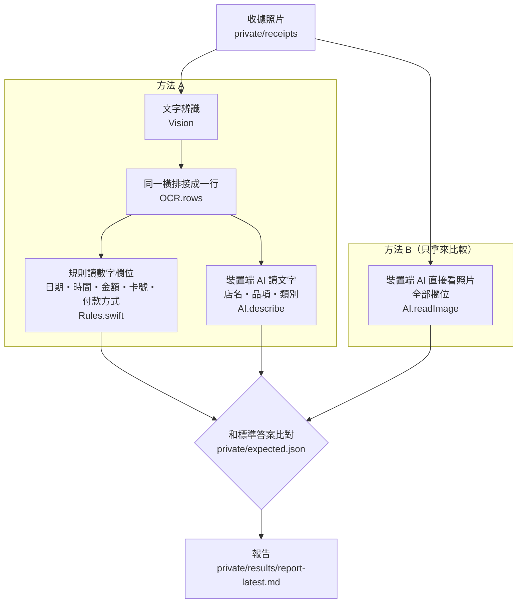
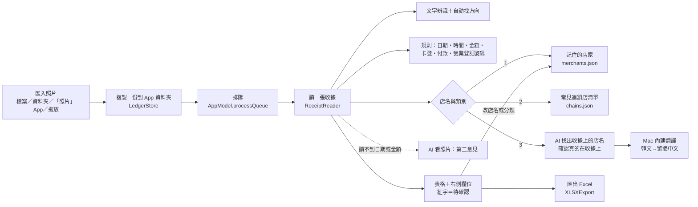

# 架構說明（給想看懂程式的人）

> 目前有兩個部分：階段 0 的「收據辨識測試工具」（命令列），和階段 1 的 Mac App（0.1 版，收據入帳＋匯出 Excel）。
> 兩者共用 `Sources/Core/` 裡的文字辨識、規則和 AI。

## 1. 階段 0 在做什麼

在寫正式 App 之前，先回答一個問題：**Mac 內建的文字辨識和 AI，讀韓文熱感紙收據到底準不準？**

做法是拿作者 2026 年 10 月釜山旅遊的 37 張真實收據（只放在作者自己 Mac 的 `private/` 資料夾，不上傳），
用兩種方法讀出欄位，再和人工確認過的「標準答案」比對。



## 2. 為什麼數字欄位不交給 AI

AI 讀不清楚的時候，可能會「猜」出一個看起來合理、但其實是錯的數字，而且很難被發現。
金額、日期、卡號這些欄位的格式很固定，用規則讀比較可靠；讀不到就留空，讓使用者確認，不會悄悄填錯。
AI 只做它比較擅長、而且錯了也容易看出來的文字工作：店名翻成中文、品項濃縮、判斷消費類別。

方法 B 讓 AI 讀全部欄位，只是為了比較。實測（37 張）它的日期只對 16 張、卡號只對 6 張，還會編出收據上沒有的店名，
而規則的各欄位都有 94～97%。所以正式版的決定是：數字一律用規則讀；規則讀不到的欄位，才把 AI 的答案標成紅字當「第二意見」給使用者參考。

**店名與類別**：AI 取的店名約一半可用、也會取錯，正式版改成：
1. 先查「記住的店家」：使用者改過一次的店家（用收據上的營業登記號碼辨認），下次直接套用。
2. 再查內建的常見連鎖店清單（Olive Young、CU、Daiso、星巴克…）。
3. 都沒有才用 Mac 內建的翻譯直譯店名；AI 只判斷類別，回答不在八類裡的（例如「飲」「藥」）由程式對應到最接近的類別。

## 3. 規則怎麼判斷（Rules.swift）

| 欄位 | 怎麼找 | 例子 |
|---|---|---|
| 日期 | 2026-10-10、2026/10/13、2026.10.14、2026년 10월 11일、26/10/11、26-10-12；也接受文字辨識讀錯的 202610~12、2026-1013、2026-10-1112:56 | 優先用「同一行後面就有時間」的日期，避開退換貨期限這類日期 |
| 時間 | 日期後面的「時:分」 | `2026-10-10 18:14:59` → 18:14 |
| 金額 | 有關鍵字的那一行，取最大的金額（那一行沒數字就看下一行）；關鍵字有先後順序 | 면세환급후 → 승인금액 → 결제금액 → Payment amount … → 합계 → Total |
| 金額（稅金檢查） | 有好幾個候選時，優先選收據上找得到「稅金≈總額÷11」或「未稅≈總額−稅金」的 | 照片拍歪讓「승인금액」對到稅金 5,544 時，仍會選對得上稅金的 61,000 |
| 金額（排除） | 含 부가세、할인、Refund、Tax total、공급가、匯率（EXCHANGE、JPY）等字的行不算 | 退稅單上的「合計稅額 6,952」不會被當成消費金額 |
| 卡號前 6 碼 | 「4 位數＋2 位數」後面接著 `*` 號（被讀成 # ※ x 也算） | `5483-68**`、`548368*****`、`4147-63**` |
| 付款方式 | LINE Pay／라인페이 → LINE Pay；현금且沒有卡號 → 現金；其他有卡號 → 刷卡 | |

收據常把「합 계」的字距拉開，所以比對關鍵字前會先去掉空白、轉小寫。

**照片方向**：先把照片當成正的讀；讀不到日期或金額時，再當成倒過來、向右轉、向左轉各讀一次，
取規則讀到最多欄位的那一次（`OCR.recognizeBestOrientation`）。第一次實測就有一張正放的收據被 Vision 讀成倒過來的字。

文字辨識會把「左邊標籤、右邊數字」拆成兩段，`OCR.rows` 依上下位置把同一橫排接回一行。
照片拍歪時，標籤和數字可能被分到不同行，這是規則讀錯的可能原因之一，報告裡會附上原始辨識內容方便檢查。

## 4. 用到的技術

| 技術 | 用途 | 說明 |
|---|---|---|
| Vision（`VNRecognizeTextRequest`） | 文字辨識 | macOS 內建，支援韓文；用「精準」模式 |
| Foundation Models（`LanguageModelSession`） | 裝置端 AI | macOS 內建的 Apple Intelligence 模型，需要開啟 Apple Intelligence |
| `NSRegularExpression` | 規則比對 | 正規表示式：描述「文字長什麼樣子」的寫法 |
| Swift 命令列工具 | 測試工具本身 | 只用命令列開發者工具編譯，不需要 Xcode |
| Translation（`TranslationSession`） | 店名翻譯 | macOS 內建的翻譯，第一次要下載語言包，之後離線翻譯 |
| SwiftUI | App 畫面 | 不用需要 Xcode 外掛的巨集（見第 5 節） |
| `/usr/bin/zip` | 匯出 Excel | macOS 內建的壓縮指令 |

**為什麼不用 `@Generable`**：Foundation Models 最方便的寫法要用 Swift 巨集，只有命令列開發者工具時可能編譯不過
（作者的另一個專案就遇過 SwiftUI 的 `@State` 編譯失敗）。所以改成請 AI 回傳 JSON 文字，再由程式解析。

**方法 B 的寫法還沒確認**：「AI 直接看圖片」是 macOS 27 的新功能，寫法是依公告推測的。
`scripts/build.sh` 會先試著連方法 B 一起編譯，失敗就改成只編譯方法 A，
並把 SDK 裡和圖片有關的寫法存到 `build/fm_image_api.txt`，下一版再依此修正。

## 5. Mac App（階段 1）



- **AppModel**（`Sources/App/AppModel.swift`）：保存行程、處理匯入佇列、修改、記住店家、翻譯、匯出。畫面只負責顯示。
- **翻譯為什麼放在畫面上啟動**：Mac 內建的翻譯（Translation 框架）要從畫面上的 `.translationTask` 開始，
  第一次需要時 macOS 會自己跳出下載語言包的視窗。`AppModel.requestTranslationIfNeeded()` 設定好要翻譯的語言，
  畫面就會呼叫 `runTranslations` 把等待翻譯的店名一次翻完。
- **記住的店家**：用營業登記號碼（`biz:217-17-25290`）和收據上的店名（`name:…`）兩種鑰匙記住同一家店；
  使用者改了中文店名或分類、或按「確認這筆」時寫入，並套用到同一個行程裡還沒確認的同一家店。
- **紅字（待確認）**：`Receipt.problems` 列出原因——日期／時間／金額讀不到、店名或類別是空的、
  或店名和類別是翻譯／AI 自動判斷的（還沒被記住或確認）、或品項是 AI 寫的（`itemsFromAI`）。
  新加的欄位一律用「可以是空的」型別（例如 `Bool?`），舊版存的帳本才讀得回來。
- **沒有 Xcode 也能編譯**：畫面狀態用 `ObservableObject`＋`@Published`，編輯中的內容放在 `Draft`、
  視窗開關放在 `UIState`，不用 `@State`、`@Observable` 這類需要 Xcode 外掛的巨集。資料用 `Codable` 存成 JSON。
- **匯出 Excel**：Excel 檔其實是 zip 壓縮的幾個 XML 檔。`XLSXExport` 自己寫出那些 XML，再用 macOS 內建的 `/usr/bin/zip` 打包。

## 6. 檔案一覽

| 檔案 | 內容 |
|---|---|
| `Sources/Core/OCR.swift` | 文字辨識、自動找照片方向、同一橫排接成一行 |
| `Sources/Core/Rules.swift` | 規則：日期、時間、金額、卡號前 6 碼、付款方式、營業登記號碼 |
| `Sources/Core/AI.swift` | 裝置端 AI：整理店名／品項／類別、直接看照片（第二意見）、解析 AI 回傳的 JSON |
| `Sources/Core/Merchants.swift` | 店名與類別：記住的店家、常見連鎖店清單、類別對應、確認 AI 給的店名真的在收據上 |
| `Sources/Core/Models.swift` | 資料格式：行程、消費、類別、付款方式；什麼情況要標紅字 |
| `Sources/Core/LedgerStore.swift` | 存檔與讀檔、複製照片、檔名重複時自動加編號 |
| `Sources/Core/ReceiptReader.swift` | 讀一張收據的完整流程 |
| `Sources/Core/XLSXExport.swift` | 匯出 Excel |
| `Sources/App/TripLedgerApp.swift` | App 入口、選單、畫面暫時狀態（UIState） |
| `Sources/App/AppModel.swift` | App 的大腦：匯入、辨識佇列、修改、記住店家、翻譯、匯出 |
| `Sources/App/ContentView.swift` | 主畫面：行程清單、消費表格、工具列、各種確認視窗 |
| `Sources/App/ReceiptInspector.swift` | 右邊面板：收據照片、可修改的欄位、第二意見、原始辨識內容 |
| `Resources/Info.plist`、`Resources/chains.json` | App 的基本資料、常見連鎖店清單 |
| `Sources/Probe/main.swift` | 測試工具的主流程：讀照片、跑兩種方法、寫報告 |
| `Sources/Probe/Report.swift` | 和標準答案比對、寫成 Markdown／CSV／JSON 報告 |
| `Sources/Probe/SelfTest.swift` | 規則的自我測試（假資料） |
| `scripts/build.sh` | 編譯（App＋測試工具） |
| `安裝.command`、`解除安裝.command` | 雙擊安裝／移除 App |
| `scripts/selftest.sh` | 自我測試 |
| `收據測試.command` | 雙擊執行：編譯＋自我測試＋跑收據＋打開報告 |
| `private/`（不上傳） | 真實收據照片、標準答案 `expected.json`、測試報告 |

## 7. 標準答案的格式（private/expected.json）

一張收據一筆，`file` 對應 `private/receipts/` 裡的檔名。下面是假資料範例：

```json
[
  {
    "file": "r01.jpg",
    "date": "2026-10-10",
    "time": "18:14",
    "amount": 30500,
    "cardPrefix": "541234",
    "pay": "card",
    "store": "가상상점",
    "nameZh": "假商店-飲料2杯",
    "category": "食"
  }
]
```

- `amount`：實際付款的原幣金額（整數，不含逗號）；退稅單寫「結帳金額」，不是退稅前的總額。
- `cardPrefix`、`pay`：收據上沒有印的寫 `null`，這一欄就不計分。
- `pay`：`card`（刷卡）、`linepay`（LINE Pay）、`cash`（現金）。

## 8. 設計決定

- **報告只存在本機**：報告裡有真實的店家、金額和收據原文，所以寫在 `private/results/`，`.gitignore` 會排除。
- **自我測試用假資料**：`SelfTest.swift` 的收據文字是照真實收據格式編的，卡號用常見的測試號碼。
- **照片只讀不寫**：測試工具不會修改、移動或刪除任何照片。
